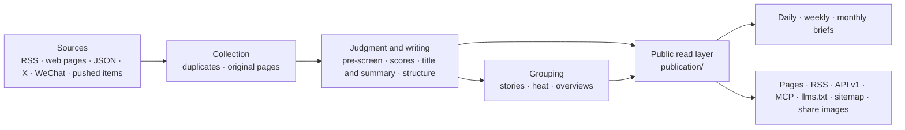

# Architecture



## Three processes

| Process | Where | What it does |
|---|---|---|
| api | `apps/api/` | Fastify. The site's own endpoints (`/api/site/`), the public API (`/api/v1/`), RSS, MCP, admin endpoints, the image proxy, share images |
| worker | `apps/worker/` | The pg-boss job queue and scheduled jobs: fetching sources, calling models, grouping, heat, daily briefs, alerts, cleanup |
| web | `apps/web/` | Server-rendered React Router pages. It reads the api over HTTP only and never touches the database |

Business code is in `packages/backend/`; types and constants shared by front and back end are in `packages/contracts/`. This site's own name, copy, brand and pages are in `site/`; the industry's categories, sources, prompts and thresholds are in `industry/`; features only this site has are in `modules/` (see "Modules" below).

## Rules that do not change

- **One public read layer.** Pages, RSS, API, MCP, sitemap and share images all read `packages/backend/src/publication/`. Public scope, pick seats (machine outputs show each piece of news once) and fact evidence conditions are defined only in `publication/scope.ts`; a new output follows the current withdrawal and full-text permissions too. A published brief keeps its writing, but whether a citation may still be public, and its source name and time, follow the current material; a withdrawal also removes introductions and covers that depend on that citation.
- **Caches do not extend the life of old content.** Changeable content is revalidated when its `Cache-Control` expires; the sitemap's process, disk and HTTP caches share one deadline that is not restarted when sending; MCP HTTP responses are `no-store`. Your own proxy or CDN must follow the same; see "Domains and HTTPS" in [Deployment](deploy.md#domains-and-https).
- **Pages call no model.** A reader opening a page only reads results already in the database; models are called only in the worker's jobs.
- **Paid requests have receipts.** Every paid request (models, X, WeChat, Jina) records a receipt first, and its result is stored before it is used. After a process restart or a job retry, results already paid for are reused instead of paid again (`providers/receipts.ts`). A receipt whose outcome is unknown is released automatically once after 30 minutes; articles that stopped as failed because of it are queued again to finish their body extraction or analysis. If the outcome is unknown again, an admin checks it on the Runs page and releases it.
- **Budget circuit breakers.** Each paid service has per-minute, per-hour and per-day limits, past which it pauses (admin Settings → Paid request limits).
- **Safety valves.** `COLLECT_ENABLED`, `MODEL_CALLS_ENABLED`, `FEISHU_CONTENT_PUSH_ENABLED`, `FEISHU_INTERNAL_ENABLED` and `INDEXNOW_SUBMIT_ENABLED` decide only whether anything goes out, not which logic runs; each is on only when set to `true`, and off when unset. The `.env` that `scripts/init-env.ts` writes turns on collection and model calls; set them to `false` while working only on the UI. In tests, pushes are always off, and collection and model calls reach only local fake services.
- **Public content is anonymous.** Admins and visitors see the same; a reader's saved items and read marks stay in the browser. The admin allows admins only.
- **Old articles don't flood the site.** Material already published more than 48 hours when found, the existing backlog of a new source's first import, and backfilled pushes are archived by their original time: not in "today", never pushed. After the first import, older backlog in a listing is not collected. Material with no trustworthy publication time is not made public until its date is read.
- **Sources are traceable.** Every pick links to the original; whether the site shows full text is the source's `site_fulltext`, which shows only a summary by default.
- **Rules are kept by the module that owns them.** The admin calls the content, story, notification and recovery modules instead of rewriting their state; business modules do not depend on the admin. Manual changes are committed together with the public result and the records recovery needs.
- **Cross-process interfaces share types.** Admin endpoints follow `packages/contracts/src/admin.ts`, and job payloads follow `JobData` in `jobs/queue.ts`, checked on both the sending and receiving side. The front end still reaches the back end only over HTTP.

`tests/architecture.test.ts` checks these module boundaries; when a boundary changes, update the convention and the check together. Site identity and each step's model come from `site/`, industry categories and prompts from `industry/`, and no site's values are hard-coded.

## Directories

| Where | Contents |
|---|---|
| `site/` | This site's own: name and copy, each step's model, brand and logo, terms pages, the four fixed files at the site root (`public/`, published with placeholders filled), the changelog, and which modules are enabled (`site/modules/`) |
| `industry/` | The industry pack: categories and tags, topics, demo sources, prompts, thresholds |
| `modules/` | Features only this site has, one folder each (see "Modules" below); the framework itself ships no module |
| `packages/backend/src/sources/` | Readers for the six kinds of sources, and fetch scheduling (`collect.ts`) |
| `packages/backend/src/content/` | Storing material, duplicates, body extraction and cleaning |
| `packages/backend/src/editorial/` | Judgment and writing: `analyze.ts` (the flow), `prompts.ts` (reading prompts), `models.ts` (the model for each step) |
| `packages/backend/src/events/` | Story grouping, heat, story overviews |
| `packages/backend/src/publication/` | The public read layer |
| `packages/backend/src/reports/` | Daily, weekly and monthly briefs |
| `packages/backend/src/providers/` | Calls to models, embeddings, X, WeChat and Jina; receipts and budgets |
| `packages/backend/src/notify/` | Feishu pushes |
| `packages/backend/src/operations/` | Alerts, backups, cleanup, IndexNow |
| `packages/backend/src/admin/` | Admin endpoints |
| `apps/web/app/routes/` | One file per page; the route table is `apps/web/app/routes.ts` |
| `database/migrations/` | Database migrations, run and recorded in order of their full file names |
| `scripts/` | Setup, migration, seed data, evaluation and check scripts |
| `tests/` | Backend tests (the database name must end in `_test` or `_ci`; see below) |

## Modules

A feature the framework lacks and only your site needs (a dedicated leaderboard or monitoring page, say) is a module: one folder per feature, `modules/<name>/`, an npm package named `@aihot/<name>` holding its own backend, endpoints, pages, styles, database migrations and tests.

| File | Contents |
|---|---|
| `module.ts` | Its addresses: pages, redirects, paths handed to the api (types in `packages/contracts/src/modules.ts`) |
| `server.ts` | Its backend hooks: endpoints, scheduled jobs, queues, event callbacks, admin page data and so on (`packages/backend/src/modules.ts`; each hook names the file that reads it) |
| `web.tsx` | Its web hooks: pages, navigation entries, parts for topic pages and the admin (`apps/web/app/modules.ts`); a part shown on one page only gives a loader so it loads with that page's code |
| `migrations/` | Its own tables, run with `database/migrations/` in file-name order |
| `tests/` | Its tests, run by `npm test` |
| Other files | Its own images and other static files also live in the module folder: register a route in the `http` hook of `server.ts` and send them with `sendFile` from `apps/api/src/routes/static.ts` (it handles type, ETag, cache headers and 404; check file names yourself), and list the address in `apiPaths` of `module.ts` |

Once written, list it in the three lists in `site/modules/`: `index.ts` for addresses, `server.ts` for the backend, `web.ts` for the web, leaving out any it lacks; then add it to `dependencies` in `site/package.json`. With Docker, add a line `COPY modules/<name>/package.json modules/<name>/` to the `Dockerfile` like the other packages. The framework imports no module and reads only those three lists, so merging later updates of this repository rarely conflicts with your own features. When the hooks are not enough, add a general hook to the framework rather than putting the feature into it.

Modules provide MCP tools through `agent.abilities`. `scripts/mcp-check.ts` always checks the full tool set; a module can give arguments in `mcp.checkArgs` that succeed on an empty database. Without them, only tools whose input schema accepts `{}` are really called with `{}`; the others are checked for discovery only, with no guessed arguments. A module tool's business behavior is tested by the module's own tests.

## Database migrations

Released migrations are deployment history and are never rewritten or deleted; fixes go in new files. Engine and module migrations follow the same convention: they run in order of their full file names and are recorded by full file name; different files with the same number each run, and one full file name cannot appear in two directories. From `0055` on, each file holds a single statement that is safe to run online; a PR adding a migration that breaks the convention is refused, and a lower number cannot be used to get around the check. This avoids one statement locking a table and then, in the same transaction, waiting on another table or scanning a lot of data.

New columns are nullable or have a constant default where possible; a CHECK or foreign key on an existing table is added `NOT VALID` first and validated in another migration. Indexes use a separate `CREATE INDEX CONCURRENTLY IF NOT EXISTS`; a released migration may not run large UPDATEs or DELETEs, or hide them in DO. Backfilling data is a separate, batched, observable operation, verified on a copy of a backup first.

When several filter conditions are correlated and the query plan badly underestimates rows because of it, you can create MCV multivariate statistics on those columns and `ANALYZE` those columns of that table in a separate migration. Check the gain on the real distribution first; add no statistics object without evidence, and do not analyze the whole database in a migration or assume success after skipping a locked table.

Destructive changes, such as changing a type or dropping a column, need their own upgrade and rollback steps and a note in [Deployment](deploy.md#updating) on what they do to existing data; the online migration check does not let them through as they are. For a table the code no longer uses, once its data can be deleted, a migration file of its own says `DROP TABLE IF EXISTS <table>` (without CASCADE, so the migration fails while anything still depends on it), noted in the deployment document as well. To allow more kinds of statements, first show they cannot block requests being served for long and add the matching checks; never turn the check off or edit the old ledger.

## Public outputs

A story's `related` link needs at least two reports to support it when it is made. The link's history is kept. When bridging reports are withdrawn, lose their standing as public fact reports, become roundups, leave the original fact, or a later grouping judgment rejects the relation, leaving fewer than two pieces of evidence, the link is not shown; it can show again once there is enough evidence. A report naturally falling out of the recall window, or an ordinary revision keeping its membership, does not expire a link. An existing link with no bridging judgment to check is not taken as withdrawn just because a record is missing; a story that cannot be read publicly is still not recommended. The meaning of `storyline` does not change with this rule, and every public output shares the read rules.

| Address | Contents |
|---|---|
| `/` `/all` `/hot` `/topics` `/daily` `/weekly` `/monthly` | Picks, all news, trending stories, topics, daily, weekly and monthly briefs |
| `/feed.xml` `/feed/full.xml` `/feed/all.xml` `/feed/daily.xml` `/feed/weekly.xml` `/feed/monthly.xml` | RSS: picks, picks with full text, everything, daily, weekly, monthly; plus `/feed/category/<key>.xml` per category and the full-text `/feed/full/category/<key>.xml` |
| `/api/v1/` | The public API, described at `/openapi-v1.json`; Markdown for agents starts at `/api/v1/agent`; the guide page is `/agent` |
| `/api/mcp` | The MCP server: one tool each for latest, search, trending, story, daily, weekly and monthly, named with the `mcpPrefix` of `site/site.ts` |
| `/llms.txt` `/sitemap.xml` `/robots.txt` | For language models and search engines (`robots.txt` and the other root files are in `site/public/`) |
| `/admin` | The admin |

## Tests

```bash
npm run typecheck
DATABASE_URL=postgres://127.0.0.1:5432/myhot_test npm test
npm run build -w @aihot/web && node --test apps/web/tests/*.test.ts
```

The database `DATABASE_URL` names must end in `_test` or `_ci`; it is created and migrated if missing. Each test file runs in parallel on its own copy, so the database account needs permission to create databases (`CREATEDB`). Tests reach no outside service: models and paid endpoints are answered by local fake services.
